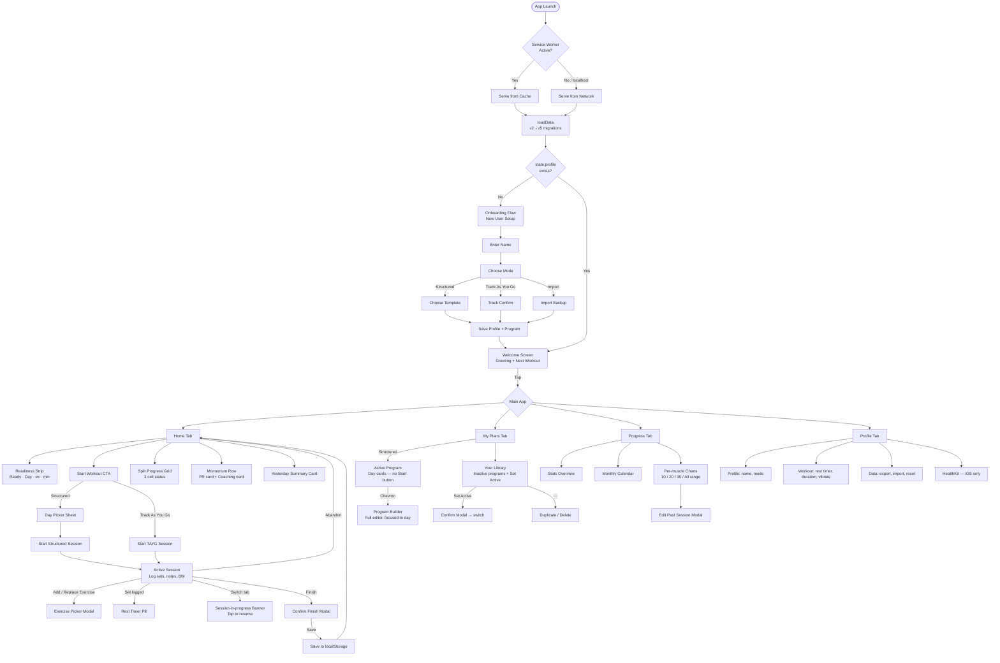
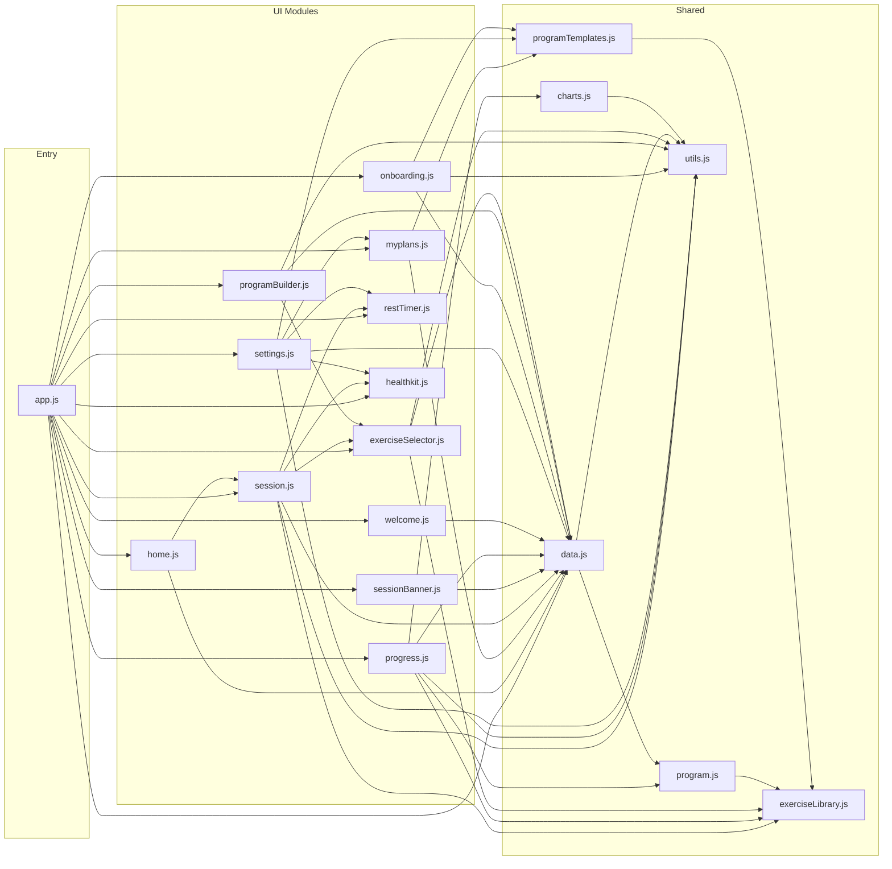
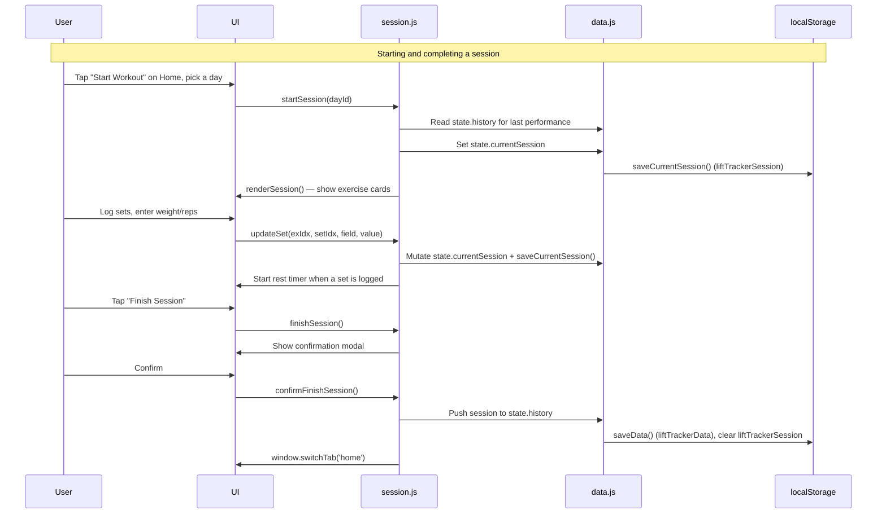
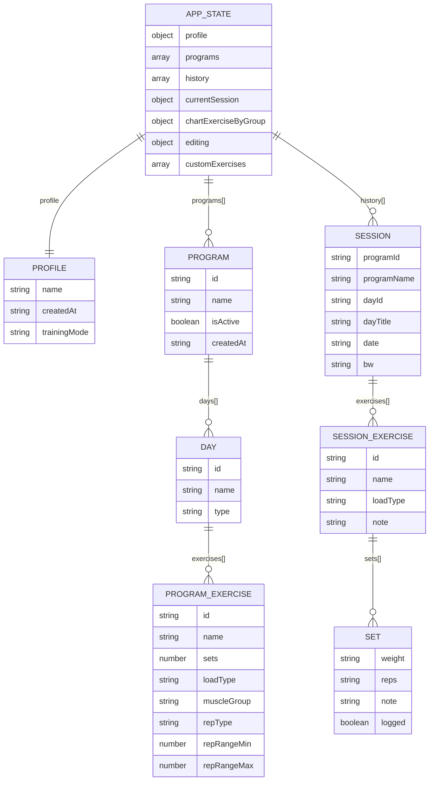
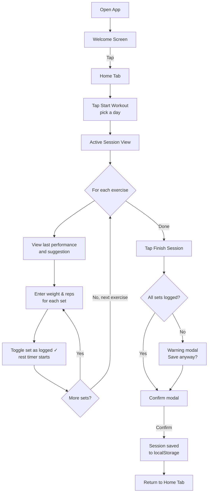
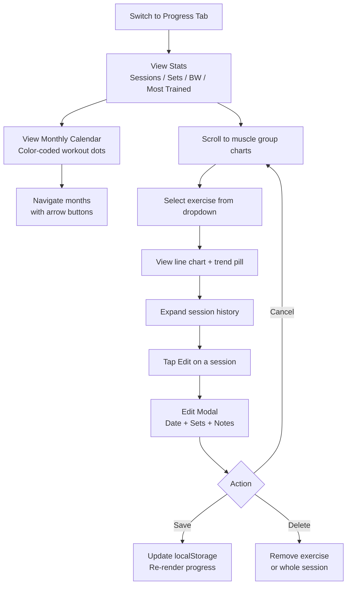
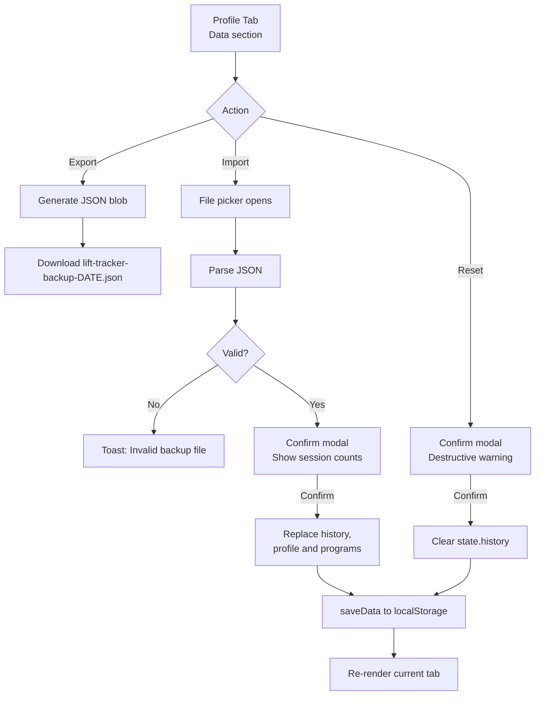
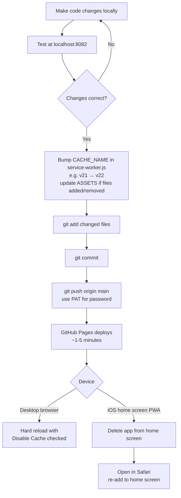

# Lift Tracker — Architecture Documentation

> **Living document.** Update this file alongside every structural code change.  
> See the bottom section for update instructions.

---

## 1. Overview

Lift Tracker is a personal workout tracking PWA. It is a **vanilla JS, no-build, no-framework** app using ES modules, CSS custom properties, and localStorage for persistence. It is deployed to GitHub Pages and installed as a home screen app on iOS.

- Single HTML shell (`index.html`) — all content rendered by JS
- Modular JS files with a single entry point (`app.js`)
- All event handlers bound to `window` in `app.js` to support inline `onclick` in dynamic HTML
- Service worker provides offline support and PWA installability

---

## 2. High-Level App Flow



---

## 3. Module Architecture



---

## 4. Module Dependencies & Responsibilities

| Module | Imports | Responsibilities |
|--------|---------|-----------------|
| `app.js` | All modules | Entry point. Binds all `window.*` handlers. Calls `loadData()`, shows onboarding if new user, otherwise `switchTab('home')` + `showWelcomeScreen()`. Registers service worker (non-localhost only). |
| `home.js` | `data.js`, `session.js` | Home tab. Week streak, readiness strip (48h rule), split progress grid (3 cell states: completed/today/future), momentum row (most recent PR computed from history + coaching via `getSuggestion`), yesterday card with volume, stat footer. |
| `myplans.js` | `data.js`, `programTemplates.js` | My Plans tab — program management workshop only (no Start buttons). Active program day cards with exercise preview + chevron → program builder. Library section with Set Active / Duplicate / Delete overflow. |
| `program.js` | `exerciseLibrary.js` | Static data: original 4-day split, `MUSCLE_GROUPS` mapping (covers all exercise library IDs), display metadata. |
| `data.js` | `utils.js`, `program.js` | `state` object (profile, programs, history, customExercises, currentSession). `loadData()` with v2→v3→v4→v5 migrations, `saveData()`, `saveCurrentSession()`, `exportData()`, `importData()`. |
| `utils.js` | _(none)_ | `todayDateString()`, `isoDateOnly()`, `formatDate()`, `formatDateShort()`, `showToast()`, `showConfirm()`, `showPrompt()`. |
| `exerciseLibrary.js` | _(none)_ | 127 exercises with id, name, muscleGroup, loadType. `MUSCLE_GROUP_ORDER`, `MUSCLE_GROUP_META`, `getExerciseById()` and search helpers. |
| `programTemplates.js` | `exerciseLibrary.js` | 6 program templates (3-day full body, 4-day upper/lower, 4-day PPL, 5-day PPL, 6-day PPL 2×, 5-day bro split). `getTemplateById()`. |
| `onboarding.js` | `data.js`, `programTemplates.js`, `utils.js` | Multi-step new-user onboarding: welcome → name → mode → template/track-as-you-go → save. Also handles backup import during onboarding. |
| `settings.js` | `data.js`, `programTemplates.js`, `myplans.js`, `restTimer.js`, `healthkit.js`, `utils.js` | Profile tab: stats card, profile editing, rest timer settings, HealthKit toggles, data backup/restore. Also holds program activate/duplicate/delete actions used by My Plans. |
| `session.js` | `data.js`, `exerciseLibrary.js`, `exerciseSelector.js`, `restTimer.js`, `healthkit.js`, `utils.js` | Structured and TAYG session lifecycle. `startSession()`, `startTrackAsYouGoWorkout()`, `renderSession()`, add/replace/remove exercise, add/remove set, reorder, `getSuggestion()` (progressive overload), `getLastPerformance()`. In-progress session persisted separately so it survives app close. |
| `programBuilder.js` | `data.js`, `exerciseSelector.js`, `utils.js` | Full-screen program editor overlay. `showProgramBuilder(editingId, focusDayId?)` — optional `focusDayId` pre-expands and scrolls to the target day. Drag-to-reorder via Sortable.js. Per-exercise sets and rep type (range / fixed / AMRAP). |
| `exerciseSelector.js` | `exerciseLibrary.js`, `data.js`, `utils.js` | Modal for picking exercises (search, muscle filter) or creating custom ones (saved to `customExercises`). |
| `restTimer.js` | _(none)_ | Floating rest timer pill. Auto-starts after set logged; stays accurate in the background (`reconcileTimer()`); traffic-light states; optional vibrate. |
| `sessionBanner.js` | `data.js` | Persistent banner shown on non-session tabs when a session is in progress. |
| `healthkit.js` | _(none)_ | iOS Capacitor HealthKit integration (steps, weight). No-ops on non-iOS. |
| `progress.js` | `data.js`, `program.js`, `exerciseLibrary.js`, `utils.js`, `charts.js` | Stats, calendar (dynamic colors by dayId hash), per-muscle charts with 10/20/30/All range (re-renders only the changed chart), sets-per-session and bodyweight charts, session history, edit modals. |
| `charts.js` | `utils.js` | `drawSingleLineChart()` — canvas-based line chart. |
| `welcome.js` | `data.js` | Splash screen using `state.profile.name` and active program's next workout. |

---

## 5. Data Flow



---

## 6. Data Schema



**localStorage key:** `liftTrackerData`  
**Schema version:** `5`  
**loadType values:** `'weight'` (barbell/dumbbell) | `'bw'` (bodyweight)  
**trainingMode values:** `'structured'` | `'trackAsYouGo'`  
**repType values:** `'range'` | `'fixed'` | `'amrap'`  
**Migrations** (run in order by `loadData()` and `importData()`):
- v2 → v3: builds default program from program.js, tags history with programId, creates profile with name "Reid"
- v3 → v4: `leg_ext_a` / `leg_ext_b` → `leg_extension`
- v4 → v5: old split-specific exercise IDs remapped to exercise-library IDs in programs and history

**Other localStorage keys:** `liftTrackerSession` (in-progress workout), `liftTimerSettings`, `liftHealthSettings`, `liftTrackerChartRanges`.  
**Personal records** are not stored — Home computes the most recent PR from history each render.

---

## 7. Key User Workflows

### Workflow 1 — Logging a Workout Session



### Workflow 2 — Reviewing Progress and Editing History



### Workflow 3 — Backup, Restore, and Reset



---

## 8. Progressive Overload Logic

Defined in `session.js`:

```
getLastPerformance(exerciseId)
  → finds most recent session in state.history containing that exercise

getSuggestion(exercise, last?)
  → top rep = upper end of the exercise's rep range (default 10)
  → if loadType === 'bw':
      best reps ≥ top rep  → "Try for <top+1>+ reps"
      otherwise            → "Match <best> reps"
  → if loadType === 'weight':
      every set hit the top rep (and enough sets were done)
                           → "Bump up: <w> → <w+5> lb"
      otherwise            → "Last: <w> × <reps>"

getLastExerciseNote(exerciseId)
  → returns { date, note } from most recent session
  → backward-compat: if no ex.note, assembles from set-level notes
    e.g. "Set 1: felt strong | Set 3: form broke"
```

These are displayed in the session view as "Last session" hints above each exercise card, and the suggestion for the next workout is surfaced on the Home tab's coaching card.

**PR detection** (`home.js`, `detectMostRecentPr()`): walks history oldest → newest keeping each exercise's best (top weight, or top reps for bodyweight); the last time any exercise beat its previous best is shown on the Home PR card.

---

## 9. Styling & Theming

All design tokens live in `:root` in `css/main.css`. **Never hardcode colors** — always use variables.

| Variable | Value | Usage |
|----------|-------|-------|
| `--bg` | `#0a0a0a` | Page background |
| `--surface` | `#141414` | Cards |
| `--surface-2` | `#1c1c1c` | Inputs, nested cards |
| `--surface-3` | `#242424` | Deeply nested elements |
| `--border` | `#262626` | Default borders |
| `--border-bright` | `#383838` | Highlighted borders |
| `--text` | `#fafafa` | Primary text |
| `--text-secondary` | `#c0c0c0` | Secondary emphasis |
| `--text-dim` | `#888` | Supporting labels |
| `--text-dimmer` | `#555` | Muted/disabled text |
| `--text-faint` | `#333` | Near-invisible chrome |
| `--accent` | `#d4ff3a` | Neon lime — primary CTAs, key highlights |
| `--accent-dim` | `#a8c82a` | Supporting accent — pills, badges, section labels |
| `--push` | `#ff6b35` | Upper A / push day |
| `--pull` | `#3a9eff` | Upper B / pull day |
| `--legs` | `#22d3ee` | Lower days (cyan) |
| `--warm` | `#ff8833` | Home: "recovering" readiness, PR tag |
| `--cool` | `#66cc88` | Home: "ready" readiness dot, coaching tag |
| `--recovery` | `#b86bff` | Lower B / posterior |
| `--success` | `#4ade80` | Confirmation states |

**Typography:**
- `Archivo Black` — display headings, large text
- `JetBrains Mono` — labels, stats, monospace UI
- `Inter Tight` — body text, secondary copy

---

## 10. Deployment & Updates



**Remote:** `https://github.com/reidrussell-alt/lifting-tracker-Application.git`  
**Auth:** Personal Access Token (GitHub no longer accepts passwords)  
**Current SW cache version:** `lift-tracker-v21`  
**Auto-update:** when a new service worker takes control, the app reloads itself. On iOS a delete + re-add is still the reliable way to force fresh code.

---

## 11. Future Roadmap

**Open**
- [ ] Show welcome screen only once per day (not every open)
- [ ] Rate difficulty (RPE) after each set — gym idea, 13 May
- [ ] Weekly/monthly volume summary on Progress tab (today: sets-per-session chart only)
- [ ] Filter Progress charts by program
- [ ] "Create plan from history" wizard for track-as-you-go users
- [ ] Swipe gestures on session cards
- [ ] Dark/light mode toggle
- [ ] Push notification reminders

**Done**
- [x] Rest timer between sets, with vibrate alert (May 2026)
- [x] Workout streak tracking — week streak on Home (May 2026)
- [x] Custom program builder (May 2026)
- [x] PR detection — most recent PR on Home (May 2026)
- [x] Chart range quick filters (May 2026)
- [x] Exercise library expanded to 100–150 (127 exercises)

---

## 12. Change Log

| Date | Change |
|------|--------|
| 2026-11-11 | App icon added (red weight plate stamped "LBS", on white): iOS home-screen icon, manifest icons, favicon; home-screen name "Lift"; SW bumped to v21 |
| 2026-11-11 | Docs refresh: ARCHITECTURE.md and CLAUDE.md brought in line with the code (schema v5, SW v20, current modules, roadmap) |
| 2026-06-05 | Fixed edit-set row overflowing on mobile; SW at v20 |
| 2026-05-30 | Refactor; PR detection on Home; per-chart re-render on range change; v4→v5 exercise-ID migration; removed `plan.js` |
| 2026-05-25 | Background-accurate rest timer; add exercise to any session (including past ones) |
| 2026-05-22 | Replace exercise and remove set mid-session; auto-reload when a new service worker takes control |
| 2026-05-15 | Home redesigned as workout launchpad (readiness, split grid, PR + coaching cards, yesterday card); My Plans as program workshop |
| 2026-05-14 | 4-tab navigation: Home, My Plans, Progress, Profile |
| 2026-05-11 | UI/UX polish: bottom nav, safe areas, touch targets |
| 2026-05-09 | Delete exercise/set in active session and past-workout edit; code-quality refactor; rest timer fixes |
| 2026-05-08 | Apple Health (Capacitor) integration groundwork |
| 2026-05-07 | Exercise library, exercise selector, program builder; rest timer with traffic-light states; chart range quick filters |
| 2026-05-04 | Multi-program support: onboarding, exercise library, 6 templates, Settings tab, track-as-you-go mode, v2→v3 data migration; SW bumped to v5 |
| 2026-05-04 | Added `ARCHITECTURE.md` and updated `CLAUDE.md` with architecture section |
| 2026-05-04 | Added welcome screen (`welcome.js`) with dynamic greeting, workout label, staggered animations, tap-to-dismiss |
| 2026-05-03 | Initial modular rebuild deployed to GitHub Pages; bumped SW to v4 |
| 2026-05-03 | Added monthly calendar view to Progress tab with color-coded workout dots |
| 2026-04-xx | Added per-exercise notes with backward compatibility for set-level notes |
| 2026-04-xx | Initial modular rebuild from single-file `preview.html` |

---

## 13. Updating This Document

**Update this file whenever you:**
- Add or remove a JS module
- Change cross-module dependencies
- Modify localStorage schema or add new fields
- Add new tabs, pages, or major UI sections
- Change the deployment process
- Complete a roadmap item

**Which section to update:**

| Change type | Section |
|-------------|---------|
| New tab or navigation | §2 High-Level App Flow |
| New JS file or import | §3 Module Architecture + §4 Dependencies |
| localStorage schema change | §6 Data Schema |
| New feature workflow | §7 Key User Workflows |
| New overload logic | §8 Progressive Overload Logic |
| New CSS variable | §9 Styling & Theming |
| Deployment process change | §10 Deployment |
| Completed or new planned feature | §11 Future Roadmap |
| Any change | §12 Change Log — add dated entry |
