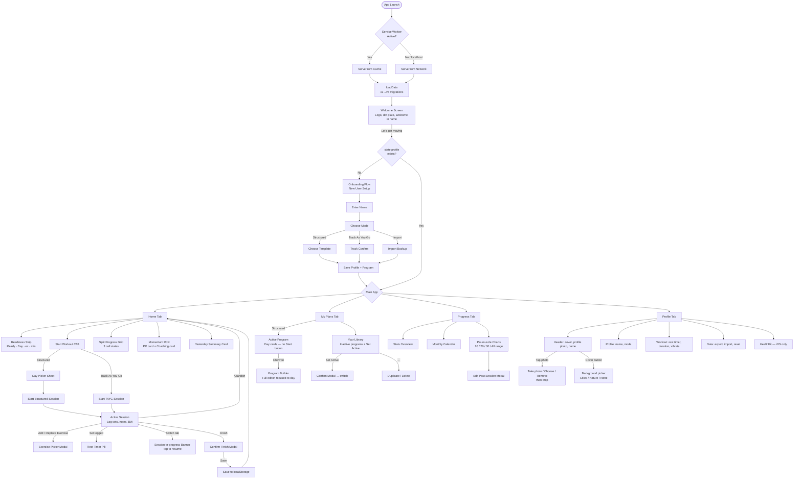
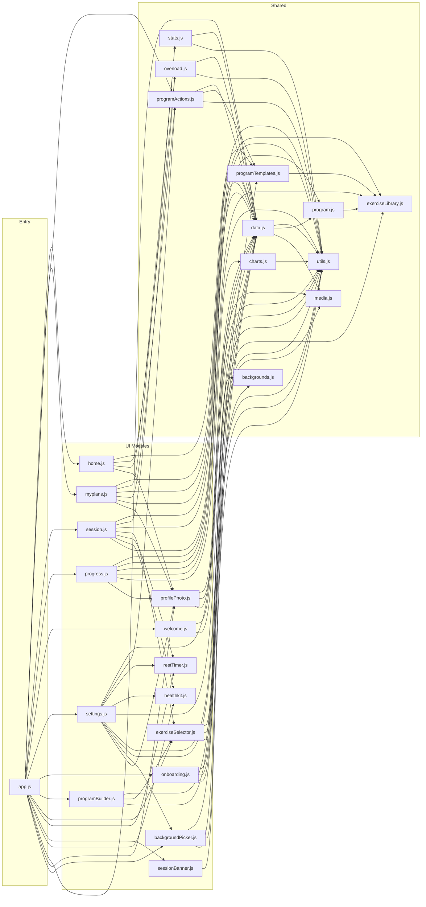
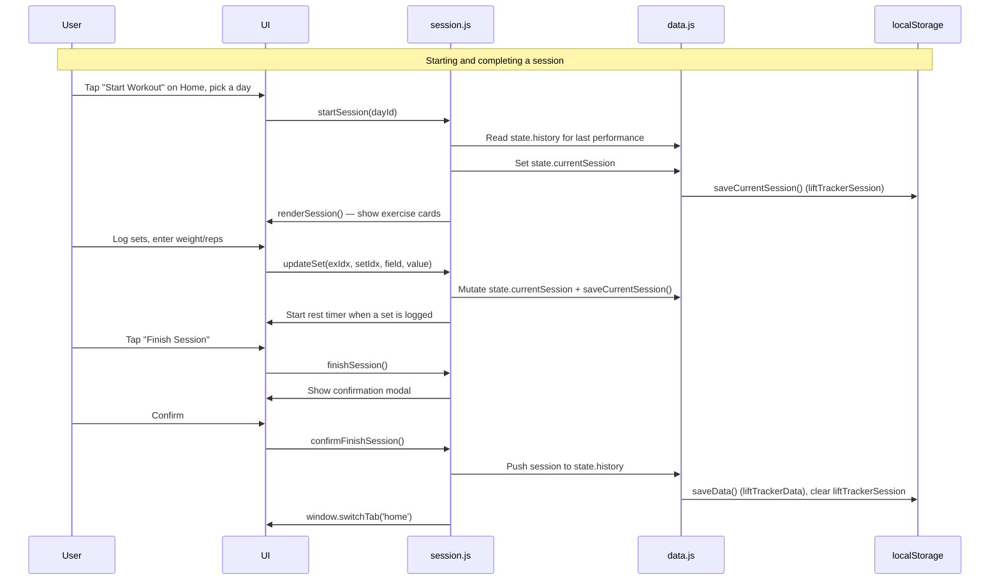
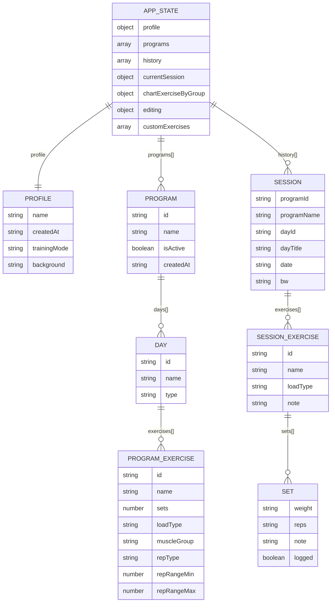
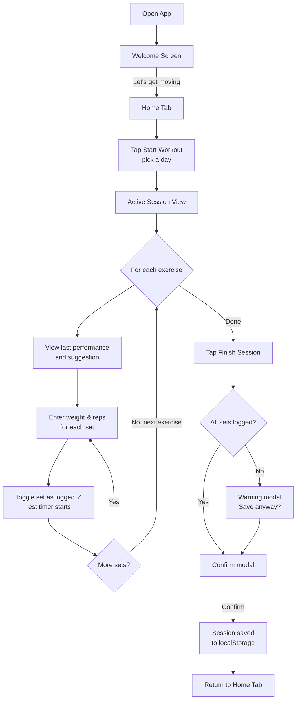
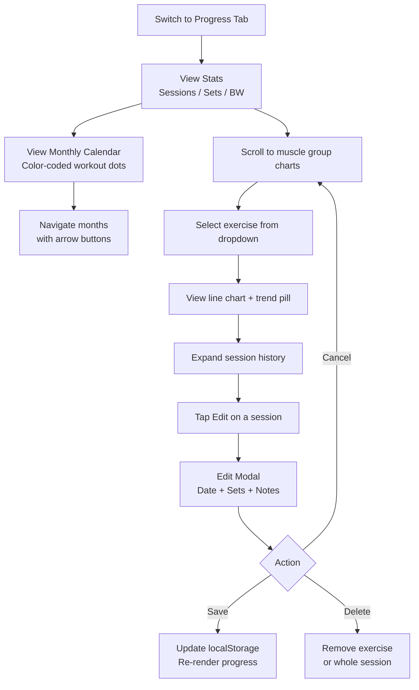
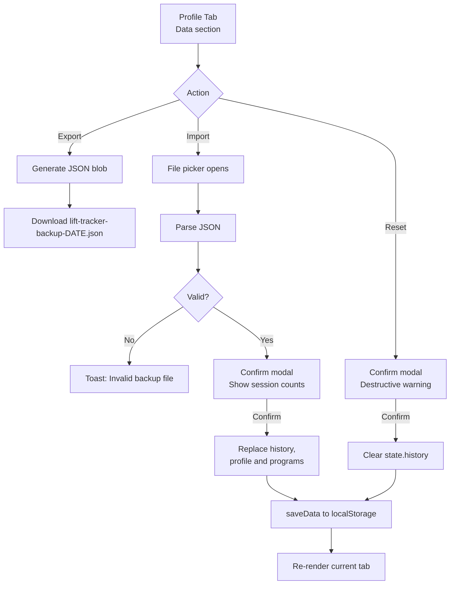
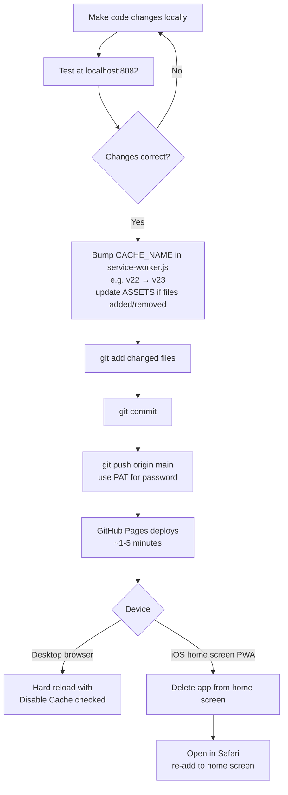

# Lift Tracker — Architecture Documentation

> **Living document.** Update this file alongside every structural code change.  
> See the bottom section for update instructions.

---

## 1. Overview

Lift Tracker is a personal workout tracking PWA. It is a **vanilla JS, no-build, no-framework** app using ES modules, CSS custom properties, and localStorage for persistence. It is deployed to GitHub Pages and installed as a home screen app on iOS.

- Single HTML shell (`index.html`) — all content rendered by JS
- Modular JS files with a single entry point (`app.js`)
- All event handlers bound to `window` in `app.js` to support inline `onclick` in dynamic HTML
- Service worker provides offline support and PWA installability

---

## 2. High-Level App Flow



---

## 3. Module Architecture



---

## 4. Module Dependencies & Responsibilities

| Module | Imports | Responsibilities |
|--------|---------|-----------------|
| `app.js` | All modules | Entry point. Binds all `window.*` handlers. Calls `loadData()`, then `showWelcomeScreen()` — for a new user its button opens onboarding, otherwise Home. Registers service worker (non-localhost only). |
| `home.js` | `data.js`, `overload.js`, `stats.js` | Home tab. Week streak, readiness strip (48h rule), split progress grid (3 cell states: completed/today/future), momentum row (most recent PR computed from history + coaching via `getSuggestion`), yesterday card with volume, stat footer. |
| `stats.js` | `data.js`, `utils.js` | Pure stats and rotation logic, no DOM: `detectMostRecentPr()`, `calcWeekStreak()`, `_weekStart()`, `getDayType()`, `abbreviateTitle()`, `abbreviateDay()`, `getSuggestedDay()` (next day in the active program's rotation). Used by Home and My Plans. |
| `myplans.js` | `data.js`, `programTemplates.js`, `stats.js` (next day), `programActions.js` (custom-plan limit), `utils.js` | My Plans tab — program management workshop only (no Start buttons). Active program day cards with exercise preview + chevron → program builder. Library section with Set Active / Duplicate / Delete overflow. |
| `program.js` | `exerciseLibrary.js` | Static data: original 4-day split, `MUSCLE_GROUPS` mapping (covers all exercise library IDs), display metadata. |
| `data.js` | `utils.js`, `program.js`, `media.js` | `state` object (profile, programs, history, customExercises, currentSession). `loadData()` with v2→v3→v4→v5 migrations (`migrateToLatest()`), `applyImportedData()` shared by both import paths, `saveData()`, `saveCurrentSession()`, `exportData()` (includes the profile photo), `importData()`. |
| `utils.js` | _(none)_ | `todayDateString()`, `isoDateOnly()`, `escapeHtml()` (shared by Profile, welcome, profile chip, program builder, background picker), `dayTitleBase()` (day title before " - "), `formatDate()`, `formatDateShort()`, `showToast()`, `showConfirm()`, `showPrompt()`. |
| `exerciseLibrary.js` | _(none)_ | 127 exercises with id, name, muscleGroup, loadType. `MUSCLE_GROUP_ORDER`, `MUSCLE_GROUP_META`, `getExerciseById()` and search helpers. |
| `programTemplates.js` | `exerciseLibrary.js` | 6 program templates (3-day full body, 4-day upper/lower, 4-day PPL, 5-day PPL, 6-day PPL 2×, 5-day bro split). `getTemplateById()`. |
| `onboarding.js` | `data.js`, `programTemplates.js`, `utils.js` | Multi-step new-user onboarding, opened from the welcome screen's button: name → mode → template/track-as-you-go → save, then Home. Also handles backup import during onboarding. |
| `settings.js` | `data.js`, `programActions.js` (re-export only), `restTimer.js`, `healthkit.js`, `utils.js`, `media.js`, `backgrounds.js`, `backgroundPicker.js` | Profile tab: header (cover — orange fade or the chosen background photo, with its credit at the bottom of the page — centred profile photo, name, member since, mode), stats card, profile editing, rest timer settings, HealthKit toggles, data backup/restore. Re-exports the program actions from `programActions.js` (kept for the program-action tests). |
| `programActions.js` | `data.js`, `programTemplates.js`, `utils.js` | Program actions used by My Plans: `setActiveProgram()`, `deleteProgram()`, `duplicateProgram()`, `duplicateTemplate()`, each confirmed first; `MAX_CUSTOM_PROGRAMS` (5). Bound to `window` in `app.js`. |
| `session.js` | `data.js`, `overload.js`, `exerciseLibrary.js`, `exerciseSelector.js`, `restTimer.js`, `healthkit.js`, `utils.js` | Structured and TAYG session lifecycle. `startSession()`, `startTrackAsYouGoWorkout()`, `renderSession()`, add/replace/remove exercise, add/remove set, reorder. In-progress session persisted separately so it survives app close. |
| `overload.js` | `data.js`, `utils.js` | Progressive overload logic, no DOM: `getLastPerformance()`, `getSuggestion()`, `getLastExerciseNote()`. Used by the workout screen and Home's coaching card. |
| `programBuilder.js` | `data.js`, `exerciseSelector.js`, `utils.js` | Full-screen program editor overlay. `showProgramBuilder(editingId, focusDayId?)` — optional `focusDayId` pre-expands and scrolls to the target day. Drag-to-reorder via Sortable.js. Per-exercise sets and rep type (range / fixed / AMRAP). |
| `exerciseSelector.js` | `exerciseLibrary.js`, `data.js`, `utils.js` | Modal for picking exercises (search, muscle filter) or creating custom ones (saved to `customExercises`). |
| `restTimer.js` | _(none)_ | Floating rest timer pill. Auto-starts after set logged; stays accurate in the background (`reconcileTimer()`); traffic-light states; optional vibrate. |
| `sessionBanner.js` | `data.js` | Persistent banner shown on non-session tabs when a session is in progress. |
| `profilePhoto.js` | `media.js`, `utils.js`, `data.js` | Profile photo options sheet (take photo with the front camera, choose from library, remove), crop step (drag + zoom in a circle), saves a 400×400 JPEG. Also builds the profile chip (name + small photo) shown top right on Home, My Plans, Progress and Profile. |
| `backgroundPicker.js` | `data.js`, `backgrounds.js`, `utils.js` | Background sheet for the Profile cover: Cities / Nature / None tabs, photo grid, live preview on the cover, photo credit, saves `profile.background`. |
| `backgrounds.js` | _(none)_ | The 36 curated cover photos (18 cities, 18 nature) from Wikimedia Commons: id, label, photographer, licence. Files in `img/backgrounds/full/` (1200px) and `img/backgrounds/thumbs/` (480×300); rebuilt by `scripts/backgrounds/`. |
| `media.js` | _(none)_ | Stores the profile photo on the device in IndexedDB (`plateLogMedia` database), separate from localStorage. Load/save/remove, and data-URL conversion for backups. |
| `healthkit.js` | _(none)_ | iOS Capacitor HealthKit integration (steps, weight). No-ops on non-iOS. |
| `progress.js` | `data.js`, `program.js`, `exerciseLibrary.js`, `utils.js`, `charts.js` | Stats, calendar (dynamic colors by dayId hash), per-muscle charts with 10/20/30/All range (re-renders only the changed chart), sets-per-session and bodyweight charts, session history, edit modals. |
| `charts.js` | `utils.js` | `drawSingleLineChart()` — canvas-based line chart. |
| `welcome.js` | `data.js`, `utils.js` | Welcome screen: plate logo, then a turning canvas disc of dots, "Welcome in, {name}" and a "Let's get moving" button that goes to Home. Respects reduced motion. |

---

## 5. Data Flow



---

## 6. Data Schema



**localStorage key:** `liftTrackerData`  
**Schema version:** `5`  
**loadType values:** `'weight'` (barbell/dumbbell) | `'bw'` (bodyweight)  
**trainingMode values:** `'structured'` | `'trackAsYouGo'`  
**repType values:** `'range'` | `'fixed'` | `'amrap'`  
**Migrations** (run in order by `migrateToLatest()`, used by `loadData()`, `importData()` and the onboarding import):
- v2 → v3: builds default program from program.js, tags history with programId, creates profile with name "Reid"
- v3 → v4: `leg_ext_a` / `leg_ext_b` → `leg_extension`
- v4 → v5: old split-specific exercise IDs remapped to exercise-library IDs in programs and history

**Cover background:** `profile.background` holds a photo id from `backgrounds.js` (or is missing/null for the orange fade). Optional, so no migration.  
**Profile photo:** kept in IndexedDB (database `plateLogMedia`, store `images`, key `avatar`) as a 400×400 JPEG, not in localStorage. Backups include it as an `avatar` data URL; restoring a backup without one keeps the current photo; Reset clears it.  
**Other localStorage keys:** `liftTrackerSession` (in-progress workout), `liftTimerSettings`, `liftHealthSettings`, `liftTrackerChartRanges`.  
**Personal records** are not stored — Home computes the most recent PR from history each render.

---

## 7. Key User Workflows

### Workflow 1 — Logging a Workout Session



### Workflow 2 — Reviewing Progress and Editing History



### Workflow 3 — Backup, Restore, and Reset



---

## 8. Progressive Overload Logic

Defined in `overload.js`:

```
getLastPerformance(exerciseId)
  → finds most recent session in state.history containing that exercise

getSuggestion(exercise, last?)
  → top rep = upper end of the exercise's rep range (default 10)
  → if loadType === 'bw':
      best reps ≥ top rep  → "Try for <top+1>+ reps"
      otherwise            → "Beat <best> reps"
  → returns { msg, value, why, bump } — msg for the workout screen, value + why for Home
  → if loadType === 'weight':
      every set hit the top rep (and enough sets were done)
                           → "Go up to <w+5> lb"
      otherwise            → "Repeat <w> lb, beat <reps> reps"

getLastExerciseNote(exerciseId)
  → returns { date, note } from most recent session
  → backward-compat: if no ex.note, assembles from set-level notes
    e.g. "Set 1: felt strong | Set 3: form broke"
```

These are displayed in the session view as "Last session" hints above each exercise card, and the suggestion for the next workout is surfaced on the Home tab's coaching card.

**PR detection** (`stats.js`, `detectMostRecentPr()`): walks history oldest → newest keeping each exercise's best (top weight, or top reps for bodyweight); the last time any exercise beat its previous best is shown on the Home PR card.

---

## 9. Styling & Theming

The app uses the **Warm Daylight** theme (16 Nov 2026): a white page, warm off-white cards with light neutral borders, dark ink text and one burnt-orange accent used sparingly. All design tokens live in `:root` in `css/main.css`. **Never hardcode colours** — use the variables, and `color-mix(in srgb, var(--token) N%, transparent)` for tints. No large colour fades or gradients, except a soft burnt-orange fade behind the top of Home (`--home-fade`, half-strength orange to white).

| Variable | Value | Usage |
|----------|-------|-------|
| `--bg` | `#ffffff` | Page background |
| `--surface` | `#f7f6f3` | Cards, grouped sections, tab bar |
| `--surface-2` | `#efede9` | Inputs, nested cards |
| `--surface-3` | `#e7e5e1` | Pressed / deeply nested |
| `--border` / `--border-bright` | `#e7e5e1` / `#d6d3cd` | Dividers, outlines |
| `--text` … `--text-faint` | `#202326` → `#c9cdd1` | 5-step neutral scale |
| `--accent` | `#bd552f` | Burnt orange — primary actions, active-workout progress, logo |
| `--accent-ink` | `#a84a27` | Small orange text on cards |
| `--on-accent` | `#ffffff` | Text on orange (4.66:1) |
| `--select` / `--on-select` | `#202326` / `#ffffff` | Selected tab, active pills and segments, toggles, focus, today |
| `--accent-dim` | `#3f454b` | Supporting labels and badges (neutral) |
| `--push` / `--pull` / `--legs` / `--recovery` | `#9c3587` / `#1a8fe0` / `#0fa678` / `#7c4dff` | Workout types only (push is plum so it can't be confused with the orange accent) |
| `--success` / `--danger` | `#0fa678` / `#cc3339` | Improvement signals; errors and destructive actions |
| `--plate` | = `--accent` | Logo mark (welcome screen; app icons drawn by `scripts/make_icons.py`) |
| `--radius-card`, `--shadow-raised` | 12px, soft shadow | Cards are flat with a hairline border; only pop-ups and sheets get a shadow |

**Typography:** `Bricolage Grotesque` for titles and big numbers (`--font-display`), `Manrope` for everything else (`--font-body`, `--font-mono`), with tabular figures so numbers line up. `IBM Plex Sans` (`--font-welcome`) is used only for the welcome screen headline.

**Rest timer:** floating circle above the tab bar; red while resting, amber in the last third, green "READY".

**Charts** read their colours from the CSS variables at draw time (`cssVar()` in `charts.js`).

---

## 10. Deployment & Updates



**Remote:** `https://github.com/reidrussell-alt/plate-log.git` (live at `https://reidrussell-alt.github.io/plate-log/`; the old `lifting-tracker-Application` repository is kept as an archive)  
**Auth:** Personal Access Token (GitHub no longer accepts passwords)  
**Current SW cache version:** `lift-tracker-v34`  
**Background photos** are not precached: the service worker keeps them in a separate `plate-log-backgrounds-v1` cache as they are viewed, and that cache survives app updates.  
**Auto-update:** when a new service worker takes control, the app reloads itself. On iOS a delete + re-add is still the reliable way to force fresh code.

---

## 11. Future Roadmap

**Open**
- [ ] Show welcome screen only once per day (not every open)
- [ ] Rate difficulty (RPE) after each set — gym idea, 13 May
- [ ] Weekly/monthly volume summary on Progress tab (today: sets-per-session chart only)
- [ ] Filter Progress charts by program
- [ ] "Create plan from history" wizard for track-as-you-go users
- [ ] Swipe gestures on session cards
- [ ] Dark version of the Daylight theme (follow the phone's dark mode)
- [ ] Push notification reminders

**Done**
- [x] Rest timer between sets, with vibrate alert (May 2026)
- [x] Workout streak tracking — week streak on Home (May 2026)
- [x] Custom program builder (May 2026)
- [x] PR detection — most recent PR on Home (May 2026)
- [x] Chart range quick filters (May 2026)
- [x] Exercise library expanded to 100–150 (127 exercises)

---

## 12. Change Log

| Date | Change |
|------|--------|
| 2026-11-16 | Your name and profile photo now sit together in a small rounded button in the top-right corner of Home, My Plans, Progress and Profile, inspired by the PayPal app. Until you add a photo it shows your initial. Tap it to jump to your profile. On Profile it sits on the cover photo and the change-background button moves to the left; the workout screen is left as it was; SW bumped to v31 |
| 2026-11-16 | The Profile tab gets a new header: a soft orange cover across the top, your profile photo in a circle in the middle, and your name with when you joined and how you train underneath. Tap the photo to take a selfie or pick one from your phone, then move and zoom it to fit the circle; you can remove it too. The photo stays on your phone, is included when you export a backup, and comes back when you restore one. A button on the cover opens a library of 36 background photos — 18 famous cities and landmarks around the world and 18 nature scenes (waterfalls, mountains, forests, deserts, northern lights) — with a live preview before you save; the photographer is credited under the photo and at the bottom of the page. Photos download the first time you see them and then work offline; SW bumped to v30 |
| 2026-11-16 | First-time users now see the same welcome screen as everyone else (plate logo, turning dots, "Welcome in") instead of the old "Welcome to Lift Tracker" page with a weightlifter emoji. Tapping "Let's get moving" walks them through setup — their name, then structured plan or track as you go — and lands them on Home. Emoji removed from the setup steps; SW bumped to v29 |
| 2026-11-16 | Home gets a soft burnt-orange glow at the top of the screen that fades to white by the "This week" card, inspired by the Copilot app. The date and day stay black, and the Start button turns white with orange text so it stands out against the colour. Only Home has it; the other tabs stay plain white |
| 2026-11-16 | Push days and the Chest chart change from orange to plum, and the Core chart from amber to teal, so orange only ever means the main action, workout progress or the logo. Remove, discard, delete and form-error messages that had borrowed the push colour now use the red danger colour everywhere. The home streak badge and a few labels lose their amber tint |
| 2026-11-16 | New colour palette, "Warm Daylight": a white page with warm off-white cards and one burnt-orange accent instead of grey and cobalt. Orange now marks only the main button on each screen, your progress during a workout (progress bar, ticked sets, finished exercises) and the logo, which changes from red to the same orange (app icon too). Tabs, filters and toggles show selection in dark ink. Delete and discard buttons are red so they can't be mistaken for the main action. All text and buttons meet contrast guidelines; SW bumped to v28 |
| 2026-11-16 | New welcome screen, inspired by the How We Feel app: the red plate logo on its own, then a calm, slowly turning ring of dots shaped like a weight plate, a simple "Welcome in, Reid" and one green "Let's get moving" button that opens Home. No workout suggestion or small print; it waits for you instead of disappearing on a timer; still for people who turn down motion. Design ideas now collected in a design-reference folder; SW bumped to v27 |
| 2026-11-13 | Workout screen: logging a set now gives a quick celebration (the tick pops, a burst of dots, and a "Set 2 done · 70 × 9" pill for 2 seconds; skipped when the phone asks for reduced motion); set numbers sit in boxes under a "Set" label; the workout name, sets-done count and progress bar stay frozen at the top while exercises scroll; SW bumped to v26 |
| 2026-11-13 | Screens from the design canvas: Home cards lead with the number ("230 lb") and say why; the workout screen shows a progress bar, keeps one exercise open and folds finished ones to a single line, puts the target next to last time's sets, and keeps Finish on screen; Progress shows three numbers in one row and a segmented range picker; My Plans groups the days in one list and marks the next one; small green text is darker so it is readable; SW bumped to v25 |
| 2026-11-13 | Look sharpened so it feels less generic: plain sentence-case labels instead of small capitals, flat cards with a thin edge instead of floating shadows, no coloured badges or emoji, Home leads with the date and a "Start Lower A"-style button, clearer coaching wording ("Go up to 70 lb"); SW bumped to v24 |
| 2026-11-13 | Restoring a backup now fully updates older backups whether you restore during first-time setup or from the Profile tab, and keeps your custom exercises; SW bumped to v23 |
| 2026-11-11 | Moved to a new GitHub repository, `plate-log`, with full history; new web address |
| 2026-11-11 | Daylight theme: light surfaces, cobalt accent, Bricolage Grotesque + Manrope, card shadows, bolder set-logging tick, light rest-timer colours, plate logo on welcome screen; status bar set to default; SW bumped to v22 |
| 2026-11-11 | App icon added (red weight plate stamped "LBS", on white): iOS home-screen icon, manifest icons, favicon; home-screen name "Lift"; SW bumped to v21 |
| 2026-11-11 | Docs refresh: ARCHITECTURE.md and CLAUDE.md brought in line with the code (schema v5, SW v20, current modules, roadmap) |
| 2026-06-05 | Fixed edit-set row overflowing on mobile; SW at v20 |
| 2026-05-30 | Refactor; PR detection on Home; per-chart re-render on range change; v4→v5 exercise-ID migration; removed `plan.js` |
| 2026-05-25 | Background-accurate rest timer; add exercise to any session (including past ones) |
| 2026-05-22 | Replace exercise and remove set mid-session; auto-reload when a new service worker takes control |
| 2026-05-15 | Home redesigned as workout launchpad (readiness, split grid, PR + coaching cards, yesterday card); My Plans as program workshop |
| 2026-05-14 | 4-tab navigation: Home, My Plans, Progress, Profile |
| 2026-05-11 | UI/UX polish: bottom nav, safe areas, touch targets |
| 2026-05-09 | Delete exercise/set in active session and past-workout edit; code-quality refactor; rest timer fixes |
| 2026-05-08 | Apple Health (Capacitor) integration groundwork |
| 2026-05-07 | Exercise library, exercise selector, program builder; rest timer with traffic-light states; chart range quick filters |
| 2026-05-04 | Multi-program support: onboarding, exercise library, 6 templates, Settings tab, track-as-you-go mode, v2→v3 data migration; SW bumped to v5 |
| 2026-05-04 | Added `ARCHITECTURE.md` and updated `CLAUDE.md` with architecture section |
| 2026-05-04 | Added welcome screen (`welcome.js`) with dynamic greeting, workout label, staggered animations, tap-to-dismiss |
| 2026-05-03 | Initial modular rebuild deployed to GitHub Pages; bumped SW to v4 |
| 2026-05-03 | Added monthly calendar view to Progress tab with color-coded workout dots |
| 2026-04-xx | Added per-exercise notes with backward compatibility for set-level notes |
| 2026-04-xx | Initial modular rebuild from single-file `preview.html` |

---

## 13. Updating This Document

**Update this file whenever you:**
- Add or remove a JS module
- Change cross-module dependencies
- Modify localStorage schema or add new fields
- Add new tabs, pages, or major UI sections
- Change the deployment process
- Complete a roadmap item

**Which section to update:**

| Change type | Section |
|-------------|---------|
| New tab or navigation | §2 High-Level App Flow |
| New JS file or import | §3 Module Architecture + §4 Dependencies |
| localStorage schema change | §6 Data Schema |
| New feature workflow | §7 Key User Workflows |
| New overload logic | §8 Progressive Overload Logic |
| New CSS variable | §9 Styling & Theming |
| Deployment process change | §10 Deployment |
| Completed or new planned feature | §11 Future Roadmap |
| Any change | §12 Change Log — add dated entry |
